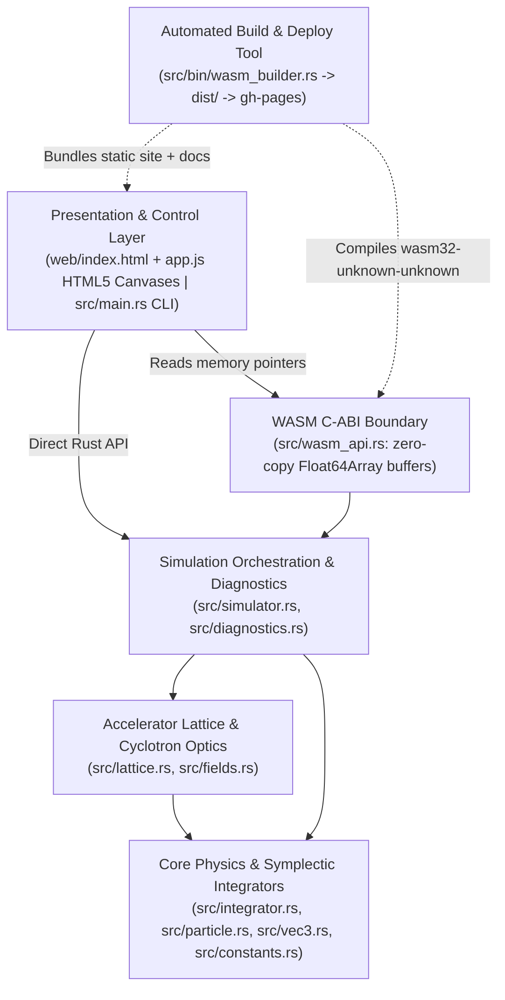
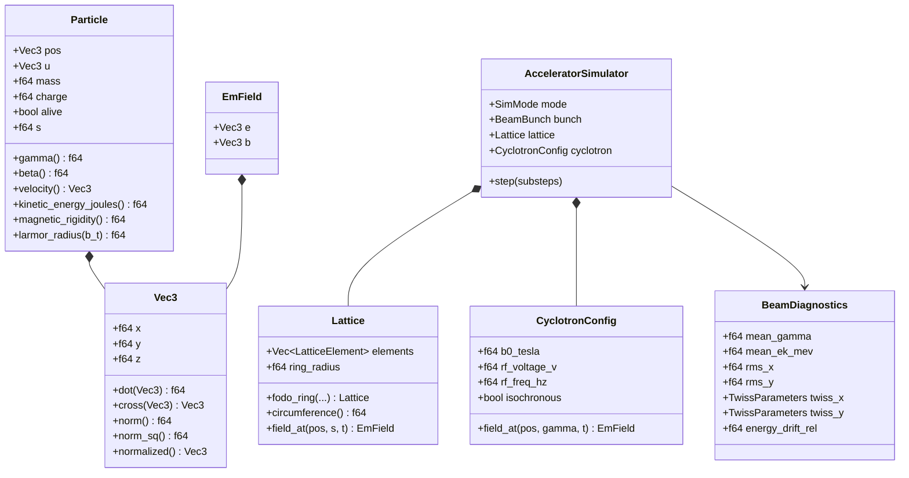
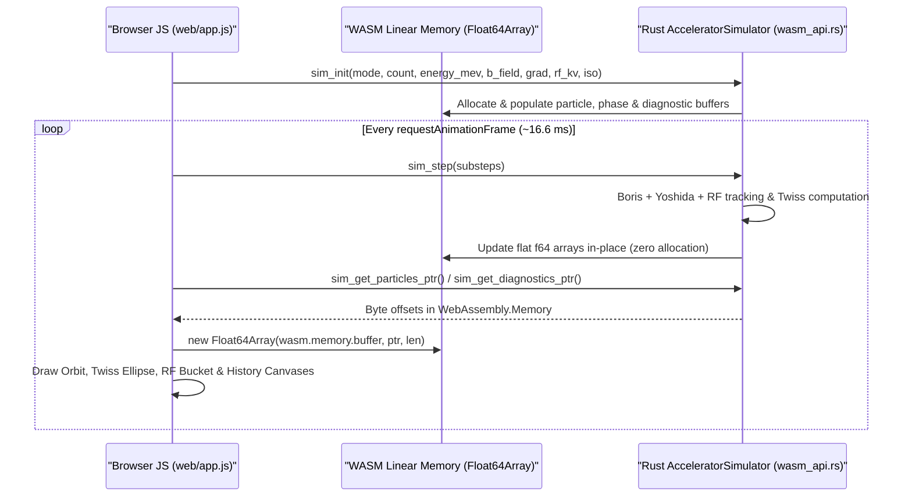

# Software Design Document (SDD)
## Relativistic Particle Accelerator Simulator (`particle-accelarator`)

- **Document ID:** `SDD-PA-001`
- **Version:** `1.0.0`
- **Standard Alignment:** IEEE Std 1016-2009 (Systems Design — Software Design Descriptions)

---

## 1. Architectural Overview
`particle-accelarator` uses a clean **4-Layer Hexagonal/Modular Architecture** in pure Rust so that identical IEEE-754 `f64` physics equations run inside:
1. Unit & TDD integration tests (`cargo test`)
2. Native CLI validation benchmarks (`particle-sim`)
3. Browser WebAssembly (`particle_accelarator.wasm` built by `wasm-builder`)

---

## 2. Module Decomposition & Data Structures

---

## 3. Core Mathematical & Numerical Algorithms

### 3.1 Cancellation-Free Relativistic Kinematics (`src/particle.rs`)
Storing proper velocity $\mathbf{u} = \gamma \mathbf{v} = \mathbf{p} / m_0$ ensures $|\mathbf{v}| = \frac{|\mathbf{u}|}{\sqrt{1 + |\mathbf{u}|^2/c^2}} < c$ for all finite `f64` values.

- **Lorentz Factor:**
  $$\gamma = \sqrt{1 + \frac{|\mathbf{u}|^2}{c^2}}$$
- **Cancellation-Free Kinetic Energy:**
  Standard $(\gamma - 1) m_0 c^2$ loses mantissa bits when $|\mathbf{u}| \ll c$. Using the algebraic identity $\gamma^2 - 1 = (\gamma - 1)(\gamma + 1) = |\mathbf{u}|^2 / c^2$:
  $$E_k = \frac{m_0 |\mathbf{u}|^2}{\gamma + 1}$$
- **Inverse Initialization from $E_k$:**
  $$\delta = \frac{E_k}{m_0 c^2}, \quad |\mathbf{u}| = c \sqrt{\delta (\delta + 2)}$$

### 3.2 Relativistic Boris Pusher (`src/integrator.rs`)
For a time step $\Delta t$ in arbitrary electric field $\mathbf{E}$ and magnetic field $\mathbf{B}$:
1. **First half electric acceleration:**
   $$\mathbf{u}^- = \mathbf{u}_n + \frac{q \Delta t}{2 m_0} \mathbf{E}$$
2. **Intermediate relativistic factor:**
   $$\gamma^- = \sqrt{1 + \frac{|\mathbf{u}^-|^2}{c^2}}$$
3. **Magnetic rotation vector & Cayley transform:**
   $$\mathbf{t} = \frac{q \Delta t}{2 m_0 \gamma^-} \mathbf{B}, \quad \mathbf{s} = \frac{2 \mathbf{t}}{1 + |\mathbf{t}|^2}$$
   $$\mathbf{u}' = \mathbf{u}^- + \mathbf{u}^- \times \mathbf{t}$$
   $$\mathbf{u}^+ = \mathbf{u}^- + \mathbf{u}' \times \mathbf{s}$$
   Because $|\mathbf{u}^+| = |\mathbf{u}^-|$ algebraically to IEEE-754 rounding limits, pure magnetic fields conserve $\gamma$ to machine precision ($< 10^{-14}$) over arbitrarily many steps.
4. **Second half electric acceleration & position drift:**
   $$\mathbf{u}_{n+1} = \mathbf{u}^+ + \frac{q \Delta t}{2 m_0} \mathbf{E}$$
   $$\gamma_{n+1} = \sqrt{1 + \frac{|\mathbf{u}_{n+1}|^2}{c^2}}, \quad \mathbf{r}_{n+1} = \mathbf{r}_n + \frac{\mathbf{u}_{n+1}}{\gamma_{n+1}} \Delta t$$

### 3.3 4th-Order Yoshida Symplectic Integrator (`src/integrator.rs`)
For transverse betatron Hamiltonian $H(x, p_x, y, p_y) = T(p_x, p_y) + V(x, y)$ with drift $T = \frac{1}{2}(p_x^2 + p_y^2)$ and magnetic multipole potential $V(x, y) = \frac{1}{2} K_1 (x^2 - y^2) + \frac{1}{6} K_2 (x^3 - 3 x y^2)$:

Using exact Forest–Ruth / Yoshida cube-root weights:
$$w_0 = -\frac{2^{1/3}}{2 - 2^{1/3}}, \quad w_1 = \frac{1}{2 - 2^{1/3}}$$
$$c_1 = c_4 = \frac{w_1}{2}, \quad c_2 = c_3 = \frac{w_0 + w_1}{2}, \quad d_1 = d_3 = w_1, \quad d_2 = w_0$$

Each longitudinal step $\Delta s$ executes 4 drifts interleaved with 3 exact symplectic kicks:
- Drift $(c_1 \Delta s)$ $\to$ Kick $(d_1 \Delta s)$ $\to$ Drift $(c_2 \Delta s)$ $\to$ Kick $(d_2 \Delta s)$ $\to$ Drift $(c_3 \Delta s)$ $\to$ Kick $(d_3 \Delta s)$ $\to$ Drift $(c_4 \Delta s)$.

### 3.4 Courant-Snyder Twiss & Emittance Extraction (`src/diagnostics.rs`)
Given particle transverse coordinates $(x_i, x'_i)$ relative to bunch centroid $(\bar{x}, \bar{x}')$:
$$\sigma_{xx} = \langle (x_i - \bar{x})^2 \rangle, \quad \sigma_{x'x'} = \langle (x'_i - \bar{x}')^2 \rangle, \quad \sigma_{xx'} = \langle (x_i - \bar{x})(x'_i - \bar{x}') \rangle$$
$$\varepsilon_x = \sqrt{\sigma_{xx} \sigma_{x'x'} - \sigma_{xx'}^2}, \quad \varepsilon_{n,x} = \langle \beta \gamma \rangle \varepsilon_x$$
$$\beta_x = \frac{\sigma_{xx}}{\varepsilon_x}, \quad \gamma_x = \frac{\sigma_{x'x'}}{\varepsilon_x}, \quad \alpha_x = -\frac{\sigma_{xx'}}{\varepsilon_x}$$

---

## 4. WebAssembly Zero-Copy Memory & Execution Flow

To avoid string/JSON marshaling inside 60 FPS animation loops, Rust maintains pre-allocated `Vec<f64>` buffers and exposes raw pointers into WebAssembly linear memory:

### Buffer Layouts
1. **Particles Buffer (`sim_get_particles_ptr()`, `8 * N` `f64`s):**
   `[x, y, z, vx, vy, vz, gamma, ek_mev]`
2. **Phase Space Buffer (`sim_get_phase_space_ptr()`, `6 * N` `f64`s):**
   `[x_m, xp_rad, y_m, yp_rad, dphi_rad, de_mev]`
3. **Diagnostics Buffer (`sim_get_diagnostics_ptr()`, `20` `f64`s):**
   - `[0]` mean $\gamma$, `[1]` mean $\beta$, `[2]` mean $E_k$ ($\text{MeV}$), `[3]` magnetic rigidity $B\rho$ ($\text{T}\cdot\text{m}$)
   - `[4]` Larmor radius $r_L$ ($\text{m}$), `[5]` cyclotron frequency $f_c$ ($\text{MHz}$), `[6]` RMS $\sigma_x$ ($\text{mm}$), `[7]` RMS $\sigma_y$ ($\text{mm}$)
   - `[8]` geometric emittance $\varepsilon_x$ ($\text{mm}\cdot\text{mrad}$), `[9]` normalized $\varepsilon_{n,x}$ ($\text{mm}\cdot\text{mrad}$)
   - `[10]` Twiss $\alpha_x$, `[11]` Twiss $\beta_x$ ($\text{m}$), `[12]` Twiss $\gamma_x$ ($\text{m}^{-1}$)
   - `[13]` relative energy conservation error $|\Delta\gamma / \gamma_0|$, `[14]` synchrotron radiation power $P_\gamma$ ($\text{W}$)
   - `[15]` turns completed, `[16]` elapsed time ($\mu\text{s}$), `[17]` survival fraction, `[18]` Twiss identity residual $|\beta\gamma - \alpha^2 - 1|$, `[19]` ring/extraction radius ($\text{m}$)

---

## 5. `wasm-builder` Build & GitHub Pages Deployment Design (`src/bin/wasm_builder.rs`)
1. Verify `wasm32-unknown-unknown` target via `rustup target list --installed` (auto-installing if missing).
2. Execute `cargo build --target wasm32-unknown-unknown --release --lib`.
3. Validate the compiled `.wasm` magic header (`\x00asm\x01\x00\x00\x00`) and copy it to `dist/particle_accelarator.wasm`.
4. Copy `web/index.html`, `web/styles.css`, `web/app.js`, and `docs/*.md` into `dist/`, and generate `dist/.nojekyll`.
5. When invoked with `--deploy`, initialize an isolated temporary git commit inside `dist/` and force-push to `origin/gh-pages` so the source working tree stays pristine.
