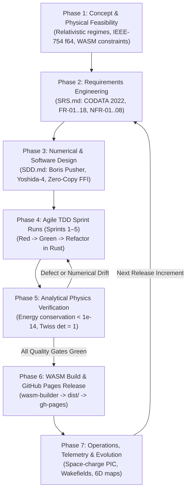

# Software Development Life Cycle (SDLC) Document
## Project: Relativistic Particle Accelerator Simulator (`particle-accelarator`)

- **Document ID:** `SDLC-PA-001`
- **Version:** `1.0.0`
- **Standard Alignment:** ISO/IEC/IEEE 12207 (Systems and Software Engineering — Software Life Cycle Processes)
- **Methodology:** Hybrid Iterative Scientific Agile-TDD (Scrum Sprints + Red-Green-Refactor Verification)
- **Target Platforms:** Native Rust (`rlib`, CLI) & WebAssembly (`wasm32-unknown-unknown` on GitHub Pages)

---

## 1. Purpose and Scope
This Software Development Life Cycle (SDLC) document defines the end-to-end engineering governance, phase gates, verification standards, risk controls, and release processes used to build, validate, and deploy the **Relativistic Particle Accelerator Simulator** (`particle-accelarator`).

Because scientific particle tracking requires strict preservation of physical invariants (relativity $v < c$, symplectic phase-space area conservation, energy invariance in static magnetic fields, and Liouville's theorem), the SDLC integrates **Analytical Physics Validation** directly into every iterative **Test-Driven Development (TDD)** cycle before any code reaches deployment.

---

## 2. Chosen SDLC Model: Iterative Scientific Agile-TDD
Traditional Waterfall fails for numerical simulation tools when subtle floating-point cancellation or non-symplectic drift surfaces late in integration. Pure ad-hoc Agile fails when physics invariants are sacrificed for UI velocity. Therefore, this project adopts a **7-Phase Iterative Scientific Agile-TDD Life Cycle**:

---

## 3. SDLC Phase Specifications & Exit Criteria

### Phase 1: Concept, Domain Modeling & Physical Feasibility Analysis
- **Objective:** Establish the physical boundaries and numerical feasibility of running a high-accuracy relativistic accelerator simulator in both native Rust and browser WebAssembly (`wasm32-unknown-unknown`).
- **Key Activities:**
  1. Analyze relativistic kinematics across 12 orders of magnitude in energy: from low-energy injection ($10\text{ eV}$ protons) to ultra-relativistic colliders ($7\text{ TeV}$ LHC protons, $\gamma \approx 7460.5$).
  2. Identify floating-point catastrophic cancellation risks when computing $E_k = (\gamma - 1) m_0 c^2$ at $\beta \ll 1$, selecting proper velocity $\mathbf{u} = \gamma \mathbf{v}$ and the rationalized identity $E_k = \frac{m_0 |\mathbf{u}|^2}{\gamma + 1}$ as primary state formulation.
  3. Confirm WebAssembly constraints: zero OS syscalls (`std::time`, OS entropy, filesystem) inside core physics modules (`src/lib.rs`) so `wasm32-unknown-unknown` builds cleanly with zero external crate dependencies.
- **Deliverables:** Feasibility baseline, state-representation decision record.
- **Exit Gate G1:** State variables ($\mathbf{r}, \mathbf{u} = \gamma\mathbf{v}$) and zero-dependency `f64` architecture approved.

### Phase 2: Requirements Engineering & Traceability
- **Objective:** Specify unambiguous, testable physical, functional, performance, and interface requirements.
- **Key Activities:**
  1. Author IEEE-830 / ISO/IEC/IEEE 29148 compliant **Software Requirements Specification** ([SRS.md](SRS.md)).
  2. Lock physical constants to **CODATA 2022** exact SI values ($c = 299\,792\,458\text{ m/s}$, $e = 1.602\,176\,634 \times 10^{-19}\text{ C}$, etc.).
  3. Define quantitative tolerances (`< 1e-14` relative energy drift in pure magnetic fields, `< 1e-12` Courant-Snyder identity error, `< 16 ms` per 60 FPS WASM frame).
  4. Establish the Requirements Traceability Matrix (RTM) binding every `FR-*` and `NFR-*` to source files and TDD tests.
- **Deliverables:** `docs/SRS.md`.
- **Exit Gate G2:** All requirements numbered, prioritized, and paired with quantitative acceptance criteria.

### Phase 3: Architectural & Numerical Design
- **Objective:** Design modular Rust boundaries, symplectic time-integration schemes, and zero-copy WebAssembly memory layouts.
- **Key Activities:**
  1. Author **Software Design Document** ([SDD.md](SDD.md)).
  2. Evaluate numerical integrators: reject Euler and non-symplectic RK4 for long-term storage ring tracking due to secular energy drift; select **Relativistic Boris Pusher** (phase-space volume preserving) for 3D $\mathbf{E},\mathbf{B}$ fields and **4th-Order Yoshida Symplectic Integrator** for Hamiltonian transverse FODO optics.
  3. Design flat `Float64Array`-aligned memory buffers (`sim_get_particles_ptr`, `sim_get_phase_space_ptr`, `sim_get_diagnostics_ptr`) so JavaScript reads Rust simulation telemetry without JSON serialization overhead.
  4. Design `wasm-builder` (`src/bin/wasm_builder.rs`) as a deterministic, self-contained Rust build-and-deploy binary for `gh-pages`.
- **Deliverables:** `docs/SDD.md`.
- **Exit Gate G3:** Module interfaces, memory layout offsets, and mathematical algorithms reviewed.

### Phase 4: Test-Driven Implementation (Agile Scrum Sprints 1–5)
- **Objective:** Incrementally build the simulator via strict **Red → Green → Refactor** loops across 5 structured sprints documented in [AGILE_TDD_PLAN.md](AGILE_TDD_PLAN.md).
- **Sprint Cadence:**
  - **Sprint 1:** Constants, `Vec3`, Relativistic `Particle` Kinematics & Cancellation-Free Energy
  - **Sprint 2:** Electromagnetic Fields & Relativistic Boris Pusher
  - **Sprint 3:** FODO Accelerator Lattice & 4th-Order Yoshida Symplectic Integrator
  - **Sprint 4:** RF Cavity Acceleration, Synchrotron Bucket & Isochronous/Classical Cyclotron
  - **Sprint 5:** Courant-Snyder Twiss Diagnostics, WASM C-ABI FFI, Dashboard & `wasm-builder`
- **Commit & Version Control Policy:** Atomic, logical commits pushed to GitHub after every verified milestone using Conventional Commits (`docs:`, `feat(physics):`, `feat(simulator):`, `feat(wasm):`).
- **Exit Gate G4:** Zero compiler warnings (`cargo clippy` / `cargo check`), 100% passing unit and TDD sprint integration tests (`cargo test`).

### Phase 5: Verification, Analytical Physics Validation & Benchmarking
- **Objective:** Independently verify that simulated physics matches analytical accelerator theory and conservation laws.
- **Verification Matrix:**
  1. **Analytical Larmor Radius & Cyclotron Period Check:** Verify gyroradius $r_L = \frac{\gamma m_0 v_\perp}{|q|B}$ and return-to-origin period $T_c = \frac{2\pi \gamma m_0}{|q|B}$.
  2. **Long-Term Energy Conservation:** Track proton over $10\,000$ steps in $2.0\text{ T}$ uniform dipole field; assert $|\gamma_N - \gamma_0| / \gamma_0 < 10^{-14}$.
  3. **Courant-Snyder Stability Criterion:** Confirm betatron oscillation boundedness for focal length $f > L/4$ and exponential blow-up for $f < L/4$.
  4. **Liouville Phase-Space Invariance:** Verify RMS transverse geometric emittance $\varepsilon_x$ conservation during linear FODO transport and Twiss identity $\beta_x \gamma_x - \alpha_x^2 = 1.0$.
  5. **WASM Binary & FFI Validation:** Verify `.wasm` magic header (`\0asm\x01\x00\x00\x00`), release LTO compilation, and zero runtime panics.
- **Exit Gate G5:** `cargo test` passes all unit + integration suites (`0 failed`), `cargo run --bin particle-sim` outputs validated physical benchmarks.

### Phase 6: Build Automation, CI/CD & GitHub Pages Deployment
- **Objective:** Package the compiled WebAssembly module, web dashboard, and engineering documentation into `dist/` and publish continuously to `gh-pages`.
- **Activities:**
  1. Execute `cargo run --bin wasm-builder` to compile `wasm32-unknown-unknown` in `--release` mode, validate binary integrity, copy `web/*` and `docs/*.md`, and create `.nojekyll`.
  2. Deploy cleanly to the `gh-pages` branch via `cargo run --bin wasm-builder -- --deploy`.
  3. Mirror the test + build + deploy lifecycle in `.github/workflows/deploy.yml` for automated GitHub Actions verification on every push.
- **Exit Gate G6:** Public repository live on GitHub, `gh-pages` branch populated, GitHub Pages active and serving `index.html` + `particle_accelarator.wasm`.

### Phase 7: Maintenance, Monitoring & Future Evolution
- **Objective:** Sustain numerical accuracy, user feedback integration, and roadmap extensibility.
- **Planned Future Increments (Backlog v0.2+):**
  - 2.5D/3D Particle-In-Cell (PIC) self-consistent space-charge Coulomb solver for high-intensity beams.
  - Synchrotron radiation damping & quantum excitation stochastic kicks for electron rings.
  - MAD-X / Elegant lattice file importer and CSV/JSON trajectory export.

---

## 4. Roles, Responsibilities & Governance

| Role | Primary Responsibilities | SDLC Artifacts Owned |
| :--- | :--- | :--- |
| **Computational Physicist / Architect** | Equations of motion, CODATA constants, symplectic schemes, conservation tolerances | `SRS.md`, `SDD.md` |
| **Rust Core & WASM Engineer** | `f64` engine, zero-dependency WASM FFI, `wasm-builder` toolchain | `src/`, `src/bin/wasm_builder.rs` |
| **QA & TDD Verification Lead** | Red-first analytical benchmarks, symplectic invariants, edge-case testing | `tests/tdd_sprints.rs`, `AGILE_TDD_PLAN.md` |
| **Release & DevOps Engineer** | Git logical branching/commits, GitHub Actions CI, `gh-pages` publishing | `.github/workflows/deploy.yml`, `SDLC.md` |

---

## 5. Risk Management Register

| Risk ID | Risk Description | Likelihood | Impact | Mitigation Strategy |
| :--- | :--- | :--- | :--- | :--- |
| **R-01** | Catastrophic floating-point cancellation in $E_k = (\gamma - 1)m_0c^2$ at low energies ($\beta < 10^{-4}$) | High | High | Use proper velocity $\mathbf{u} = \gamma\mathbf{v}$ and rationalized identity $E_k = m_0 |\mathbf{u}|^2 / (\gamma + 1)$; verify with $10\text{ eV}$ TDD test |
| **R-02** | Secular energy drift over thousands of orbital turns with Runge-Kutta integrators | High | High | Mandate Relativistic Boris Pusher & 4th-order Yoshida symplectic splitting; assert $|\Delta\gamma/\gamma_0| < 10^{-14}$ |
| **R-03** | Crate dependency incompatibility with `wasm32-unknown-unknown` (e.g., `rand`, `std::time`) | Medium | Medium | Zero external crates in core engine; implement deterministic `XorShift64Star` PRNG |
| **R-04** | Classical cyclotron phase slip at relativistic energies ($\gamma > 1.02$) | Medium | Medium | Provide dedicated Isochronous Cyclotron field profile $B(r) = \gamma(r) B_0$ and test comparative phase slip |
| **R-05** | Broken WASM loading on GitHub Pages due to Jekyll filtering or MIME/path mismatch | Low | Medium | Generate `.nojekyll` inside `dist/`, verify relative `./particle_accelarator.wasm` fetch, and include pure-JS `f64` fallback |

---

## 6. Release Quality Gate Checklist

- [x] `docs/SDLC.md`, `docs/SRS.md`, `docs/AGILE_TDD_PLAN.md`, `docs/SDD.md` complete and peer-reviewed.
- [ ] All `FR-01..FR-18` and `NFR-01..NFR-08` mapped to passing tests in `cargo test`.
- [ ] `cargo build --target wasm32-unknown-unknown --release --lib` succeeds cleanly.
- [ ] `cargo run --bin wasm-builder` generates validated `dist/particle_accelarator.wasm`.
- [ ] Logical commit history pushed to public GitHub repository `Mr-Kumar-Abhishek/particle-accelarator`.
- [ ] `gh-pages` branch deployed and serving live interactive simulator.
